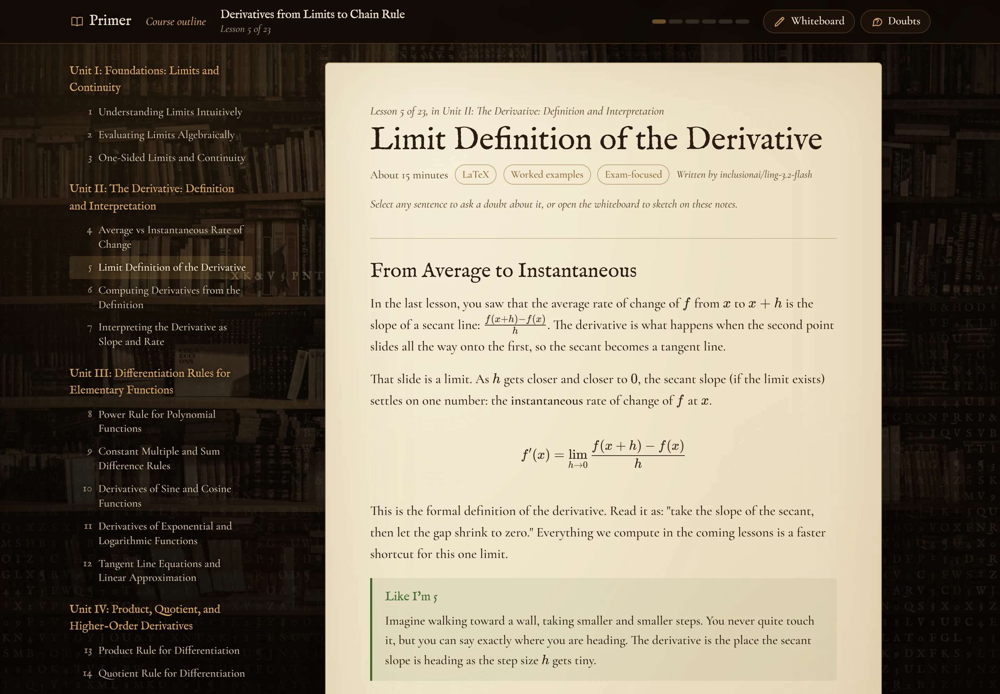

# Primer

**Type a topic. Get a whole course.**

Primer turns one topic into a full course. You name the subject, say where to start and stop, and how you like to be taught. Primer plans the lessons in the order to learn them, writes each lesson the first time you open it, and checks that you understood each part before the next one opens.



## What it does

- **Plans a course from one topic.** Topic, an optional range (“from limits to the chain rule”) and teaching instructions (LaTeX, mnemonics, worked examples, “teach me like I’m 5”). The outline is as long as the range needs.
- **Writes each lesson when you open it**, with typeset maths (KaTeX), worked examples, callouts and diagrams, then keeps it.
- **Checks you as you go.** Every part of a lesson ends with a checkpoint, and the next part isn’t on the page until you answer. A wrong answer brings back that part’s key points; a second miss adds a hint; a third lets you see the answer.
- **Doubts where they happen.** Select a sentence, or circle something on the whiteboard, and ask. The tutor answers using that part of the lesson.
- **A tutor that remembers.** A conversation on every page that knows your courses, your doubts and the questions you got wrong, so it can point out a pattern.
- **A notebook beside every lesson**: lined pages that save as you write, a sketch page, and every note in the course in one place. Drawings on the lesson are saved too.
- **Lessons read aloud** by ElevenLabs, with maths spoken as words, plus sound effects and speaking a doubt instead of typing it.
- **Twenty interface languages**: English, Hindi, Bhojpuri, Bengali, Marathi, Telugu, Tamil, Gujarati, Urdu, Kannada, Odia, Malayalam, Punjabi, Assamese, Maithili, Spanish, French, Arabic, Portuguese and Russian, with right-to-left pages for Urdu and Arabic. Each course has its own language, chosen from 42, and a lesson written in another language can be translated with one click (maths, answers and your progress stay put).
- **Watch mode.** A lesson can be followed as videos, each followed by a quiz: YouTube videos picked for the lesson (captions on, credited, with a link to YouTube’s transcript), or Primer’s own narrated videos made from the lesson, with word-by-word captions and a full transcript, narrated in the learner’s language. When a video isn’t in your language, Primer offers its own video, the text lesson or translated captions. Sign-language mode keeps captions large and finds videos by real signers (for example ISLRTC) where they exist.
- **Folders.** Group courses on shelves, add many topics at once, and get a quiet note when a topic doesn’t seem to fit its folder.
- **A shared topic library.** One general course per subject: a later request for the same or a synonymous topic reuses its lessons, cut to your range, so they open at once.
- **A community board.** Share the sources you learn from, with photos and links; threaded comments and votes. Anyone can read; sign in to take part.
- **Read a course as a book**, save it as a PDF, or download it as an EPUB with real maths.
- **Review today.** A question you get wrong comes back the next day, then three days later, until you’ve answered it right twice in a row. Each course shows how many of your mistakes you’ve fixed.
- **Class mode for teachers.** Turn a course into a class with a six-character join code. Every student gets their own copy, each lesson is written once for the whole class, and the teacher’s dashboard shows progress, the questions the class gets wrong and the doubts students ask.
- **Works offline.** Install Primer like an app and download a course: written lessons, checkpoints and notes keep working with no internet, and your progress syncs when you’re back. (Offline use needs https or localhost.)
- **Build from a syllabus.** Paste a syllabus or chapter list (NCERT, your university’s) and the course follows its chapters and order.
- **A two-minute level check** before a course sets where it starts, from the first idea you don’t know yet.
- **Answers in your own words are marked**, with short feedback and the key points you missed.
- **Real photos in lessons.** Up to two freely licensed photos per lesson from Wikimedia Commons, each credited with its author and licence, kept on the server so they work offline and in the EPUB. Courses get a cover photo too.
- **Choose how long a course is**: as long as the subject needs, concise (one unit of 1 to 5 lessons), an exact number of lessons, or a total study time.
- **Start from what you bring.** Type, paste or recite knowledge that may not be written down anywhere (Add2Knowledge), and Primer builds a course from that alone, credited to you, which you can share on the community board so it is kept. Or photograph textbook pages and learn from their text, or photograph an object and get a lesson, a unit or a course on how it works, how it’s made, its history, ethics or uses.
- **Reuses before it writes.** Before planning a new course, Primer looks for one that already covers it (your courses, the shared library, outlines shared on the community board) and offers it, so no AI credit is spent. New information on a topic revises only the lessons it affects.
- **Sources for every lesson.** Each lesson ends with its sources (Wikipedia articles, open research papers from OpenAlex, the videos it uses, or the material the course was built from), and small numbers beside each part show which source it follows.
- **Apps to practise in.** A lesson suggests real apps and websites to try what it teaches (Krita for drawing, GeoGebra for graphs), with their icon and, on hover, what the app is and how to use it for this lesson.
- **Unit exams, a final exam and your own tests.** Every unit ends with a timed exam of 10 questions (7 multiple choice, 3 in your own words). Passing it opens the next unit, and passing a later one lets you skip ahead. The final exam (2 multiple-choice questions and 1 written one per unit) marks the course complete and adds a certificate to your skill passport, which anyone can check by its code. A custom test takes the lessons, the number of each kind of question and the timer you choose. Any test prints as a worksheet with its answer key.
- **Course files: one download, the whole village learns.** Turn a course into one file and pass it on by WhatsApp, Bluetooth or a USB stick. It opens on another device with its written lessons, photos and narration, without AI credit or internet.
- **Talk to the tutor, hands-free.** Speak, pause, and hear the answer in your language; the tutor listens again. It is the same conversation, and the same memory, as the written tutor.
- **Study methods.** Pick one per course and lessons change to match: active recall, the Feynman technique (your explanation is marked), Cornell notes, mind maps, SQ3R, interleaving, spaced repetition or Pomodoro, each with how it works and why.
- **A study timer** in the top bar (Pomodoro, deep work, your own lengths, a stopwatch) that keeps running between pages, and the time you’ve studied on each course.
- **Reminders** about courses you’ve left unfinished, after 2, 7 and 30 days away (or more or less often), in a bell and as notifications.
- **A knowledge map** of each course: every lesson marked mastered, shaky, in progress, not started or locked, and the ones worth another look.
- **Your course grows.** Each course is drawn as a gilded vine that puts out leaves for every finished lesson and a crimson flower for every finished unit, and blooms when the course is done.
- **Accounts that keep everything**: courses, progress, notes, doubts and the tutor’s memory follow you to any device.
- **Risky topics are taught safely, not turned away.** A request like “bomb making” becomes a course on the chemistry and safety of explosives, and a hateful premise becomes critical history. Lessons and the tutor stay at textbook level and never give instructions for causing harm. Someone who seems to be struggling gets a supportive answer with a helpline. The only thing always refused is sexual content involving children.

## Running it

You need [Node.js](https://nodejs.org) **24.7 or newer** (Primer uses Node’s built-in SQLite and argon2id). There is nothing to install: Primer has no npm dependencies.

```bash
git clone https://github.com/Dx-Alz-xD/primer.git
cd primer
cp .env.example .env      # then add at least one AI key to .env
npm start
```

Open http://127.0.0.1:5173 and sign up. The invite code is set by `INVITE_CODE` in `.env` (the example uses `PRIMER`; leave it empty to let anyone sign up). Run the tests with `npm test`.

### Settings (`.env`)

| Setting | What it does |
| --- | --- |
| `GROQ_KEY`, `GEM_KEY`, `REQ_KEY`, `OPENROUTER_API_KEY` | AI keys for Groq, Google Gemini, Requesty and OpenRouter (the usual names like `GROQ_API_KEY` work too). Add at least one; they plan courses, write lessons and run the tutor. |
| `PRIMER_AI_ORDER` | Which providers to try, in order (default `groq,gemini,requesty,openrouter`). |
| `GROQ_MODELS`, `GEMINI_MODELS`, `REQUESTY_MODELS`, `OPENROUTER_MODELS` | Optional: each provider’s models, in order. A busy or failing model hands over to the next. |
| `INVITE_CODE` | The code sign-up asks for. Empty means open sign-up. |
| `ELEVENLABS_API_KEY` (or `EL_LAB_KEY`) | Turns on narration, Primer’s own videos, sound effects and spoken doubts. |
| `YOUTUBE_API_KEY` (or `GOOG_CLOUD`) | A Google Cloud key with the YouTube Data API enabled, for YouTube videos in Watch mode. |
| `YOUTUBE_REGION` | Optional: the region YouTube searches favour. |
| `ELEVENLABS_VOICE_ID`, `ELEVENLABS_MODEL` | Optional: another voice or model. |
| `ELEVENLABS_STT_MODEL` | Optional: the speech-to-text model for talking to the tutor (default `scribe_v2`). |
| `PRIMER_VISION_ORDER` | Which providers read photos (objects and textbook pages), in order (default Gemini first). |
| `GEMINI_VISION_MODELS`, `GROQ_VISION_MODELS`, `OPENROUTER_VISION_MODELS`, `REQUESTY_VISION_MODELS` | Optional: each provider’s photo-reading models, in order. |
| `OPENALEX_API_KEY` | Optional: an OpenAlex key, for a higher rate limit on research-paper sources. |
| `PRIMER_EXAM_PAUSE_MINUTES` | How long to wait before retaking a failed exam (default 10). |
| `WIKIMEDIA_CONTACT` | Optional: your email or web page, sent to Wikimedia so photo lookups get a higher rate limit. |
| `PORT`, `HOST` | Where the server listens (default `127.0.0.1:5173`). |

## How it’s built

- **Front end:** plain HTML, CSS and JavaScript. No framework and no build step. KaTeX for maths, a WebGL2 letter backdrop, canvas whiteboards, and [GSAP](https://gsap.com) for motion (kept in `assets/vendor/gsap` under GSAP’s standard no-charge licence). Every animation has a still version for reduced motion. The landing page's rose-grown type is adapted from [Type Garden](https://type-garden.vercel.app/) by Akshat Agarwal.
- **Server:** Node.js 24 with `node:http` and **zero npm dependencies**. Each feature is a small module in `server/` that adds its routes.
- **Data:** one SQLite file (`data/primer.db`) through the built-in `node:sqlite`.
- **AI:** Groq, Gemini, Requesty and OpenRouter, each with free models, tried in order. Every reply is repaired (LaTeX and JSON escaping), checked against the lesson format, and cached, so the same lesson is never written twice.
- **Voice and video:** ElevenLabs text to speech (with word timings for captions), sound generation and speech to text, cached in `data/audio`, with the browser’s own voice as a fallback. YouTube videos come from the YouTube Data API and play from youtube-nocookie.com only after a click.

### Security

- Passwords are hashed with **argon2id** (19 MiB memory, 2 passes, 1 lane: OWASP’s settings) through `node:crypto`, stored as PHC strings.
- Sessions are random 256-bit tokens in `HttpOnly`, `SameSite=Lax` cookies (`Secure` over HTTPS). Only their SHA-256 is stored.
- Sign-in, sign-up and the AI endpoints are rate limited. Sign-in gives the same answer for an unknown email and a wrong password, and takes the same time.
- State-changing requests from other sites are refused (Origin check). Every page has a strict Content Security Policy with a per-request nonce.
- AI-written HTML is cleaned against an allow-list every time it is shown.
- The server binds to `127.0.0.1` unless you set `HOST`, and never serves `.env`, server code or the database.

## Project layout

```
index.html, auth.html, app.html, lesson.html   pages
community.html, post.html, book.html            community board, one post, the book reader
review.html, class.html                         review of past mistakes, a teacher’s class dashboard
exam.html, paper.html                           taking an exam or test, a test on paper
certificate.html, verify.html                   the skill passport, checking a certificate
assets/js, assets/css                           front end (one file per feature)
assets/i18n                                     interface translations (19 languages besides English)
assets/css/rtl.css                              right-to-left layout for Urdu and Arabic
server/index.mjs                                HTTP server, pages, security headers
server/auth.mjs                                 accounts and sessions (argon2id)
server/data.mjs                                 courses, lessons, progress, notes, doubts
server/ai.mjs                                   AI providers: plan, write, translate, repair, check, cache
server/langs.mjs                                interface and course languages
server/videos.mjs, assets/js/video.js           Watch mode: YouTube picks, quizzes, Primer’s own videos, sign language
server/tutor.mjs                                doubt answers and the tutor
server/voice.mjs                                ElevenLabs narration, sound effects, speech to text
server/folders.mjs, server/library.mjs          folders and the shared topic library
server/community.mjs                            posts, comments, votes, photos
server/safety.mjs                               safe framing for risky topics
server/review.mjs                               the review schedule for past mistakes
server/classes.mjs                              classes, join codes, the class dashboard
server/placement.mjs, server/marking.mjs        the level check, marking written answers
server/offline.mjs, assets/js/sw.js             the installable app and offline courses
server/photos.mjs                               lesson photos from Wikimedia Commons, with credits
assets/icons                                    app icons
server/ebook.mjs, server/translate.mjs          the book view, lesson translation
server/length.mjs                               course length
server/sources-in.mjs                           courses from your knowledge, a photo or textbook pages
server/reuse.mjs                                reusing a course that already exists, revising one
server/refs.mjs, sources.mjs, apps.mjs          a lesson's sources and the apps to practise it in
server/exams.mjs                                unit and final exams, tests, the skill passport
server/packs.mjs, assets/js/packfmt.js          course files
server/talk.mjs                                 talking to the tutor
server/study.mjs, server/reminders.mjs          study methods, time studied, reminders
server/features.mjs                             the list of feature modules
assets/js/garden.js, typegarden.js              the course garden; the topic in gold growing roses (after Type Garden)
assets/js/landing-fx.js                         the landing page's motion
assets/vendor/gsap                              GSAP (core, ScrollTrigger, SplitText, ScrambleText)
docs/                                           images for this README
```
